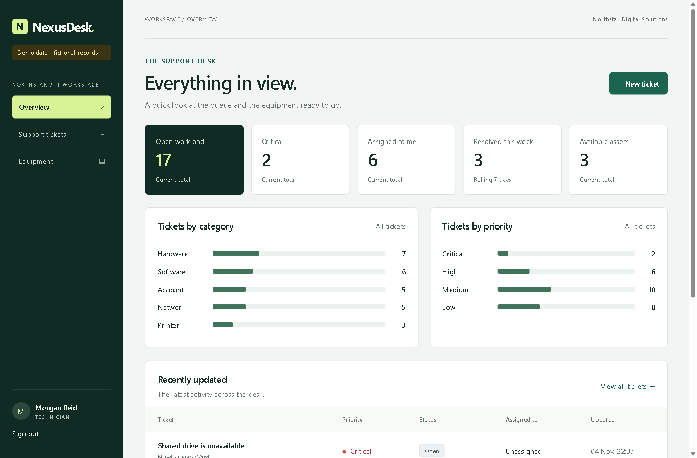
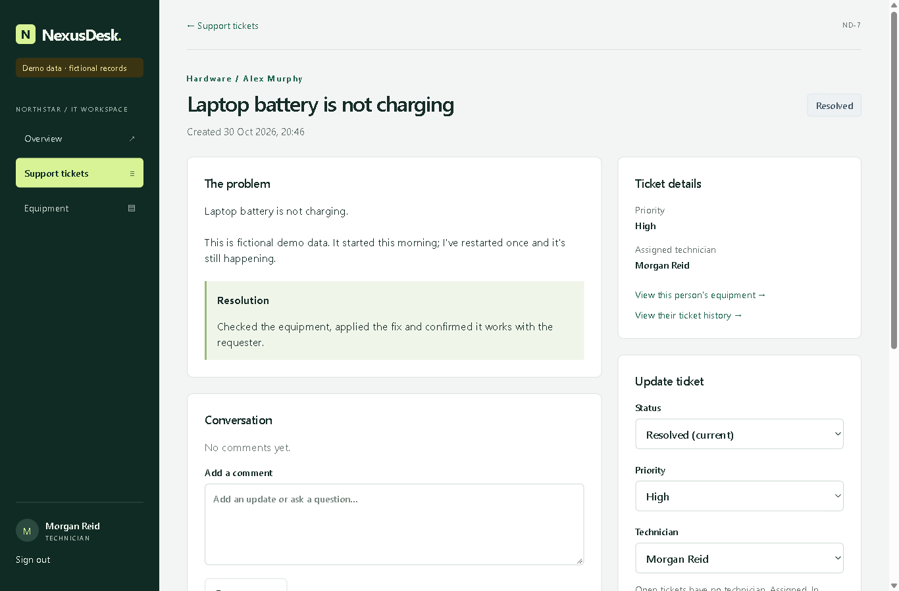
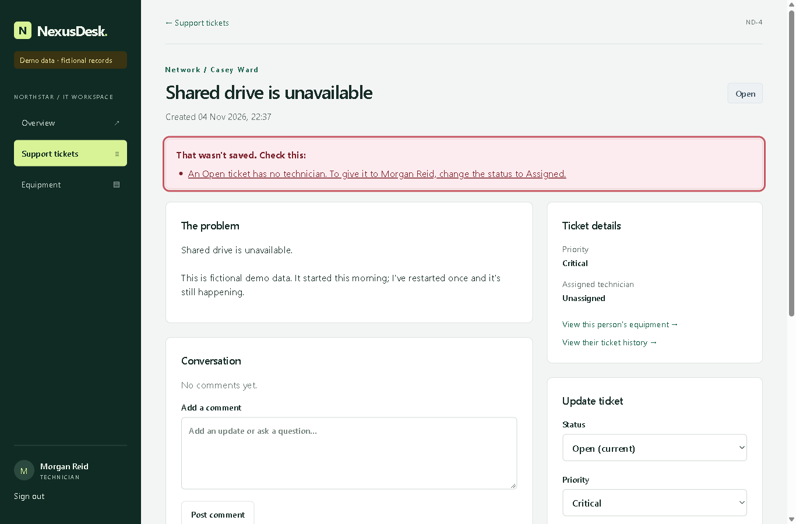
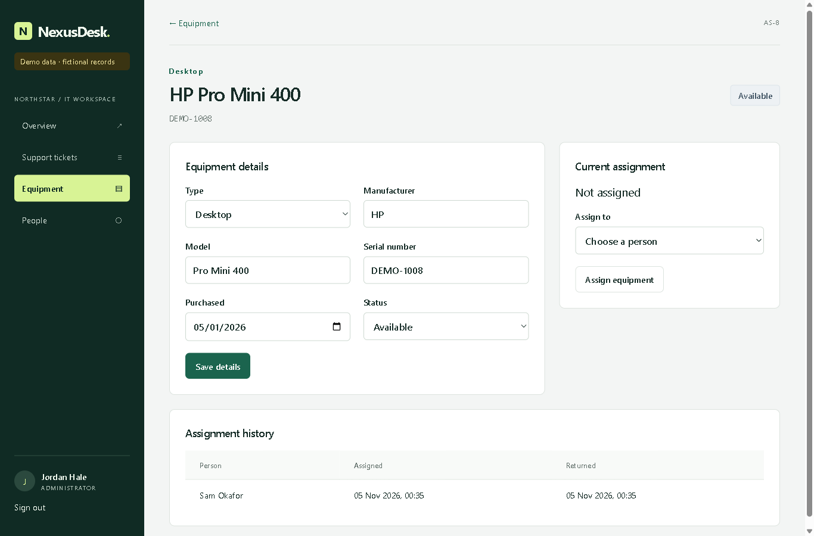

# NexusDesk

I wanted a project where Java and SQL do something useful. NexusDesk is a small IT helpdesk: employees report problems, IT staff work through them, and an administrator keeps track of company equipment and accounts.

I wrote the brief myself as practice, for a fictional company called Northstar Digital Solutions. It isn't a real client, it isn't coursework, it has no users, and it isn't production software.

**How it was built:** I set the brief. Codex built the first version (0.1.0) in two sessions on 1–2 October 2026, including the code, tests, docs and screenshots. Claude (Anthropic's AI assistant, in Claude Code) made version 0.2.0 on 4–5 November 2026 at my request: fixing the ticket assignment bug and password hashing, adding sign-in throttling, pagination and field-level validation, separating the demo, adding backup tooling and tests, and rewriting these docs. Claude also made 0.2.1 (the browser demo's sandbox mode and a Windows download fix) on 5 November 2026. Those commits carry a `Co-Authored-By: Claude` trailer. I haven't changed the code myself yet; I'm working through it using the [walkthrough](docs/walkthrough.md).



## What it does

- Raise, assign, prioritise, resolve, close and reopen support tickets, with comments and a permanent history.
- Search ticket titles and filter by status, priority, category, person and date, 20 tickets per page.
- Register equipment, assign it, return it and see who had it before.
- Create, edit and disable accounts. Disabled people are signed out on their next click.
- See workload totals and category/priority charts.

| Account | Access |
| --- | --- |
| Employee | Raise tickets, read and comment on their own, see equipment assigned to them |
| Technician | Work on every ticket, see people's ticket and equipment history, use the dashboard |
| Administrator | Technician access plus accounts and equipment |

**The ticket rule:** an Open ticket never has a technician, and every other status always has one. If you pick a technician on an Open ticket, the form switches the status to Assigned for you (and says so); the server enforces the same rule and explains it beside the field if the two don't match. Reopening returns a ticket to the queue unassigned, and earlier fixes stay in its history.

## Download and run the demo

The [latest release](https://github.com/JamieP-205/NexusDesk/releases/latest) has `NexusDesk-0.2.1-demo.zip`. You need **Java 17 or newer** ([Eclipse Temurin](https://adoptium.net/) is a good choice; check with `java -version`). Extract the whole ZIP, then double-click **Start demo.cmd**, or open a terminal in the extracted folder and run:

```
java -jar nexusdesk-0.2.1.jar --demo
```

Your browser opens when it's ready. No administrator rights are needed. Demo data is kept in `%LOCALAPPDATA%\NexusDesk\demo` (on macOS/Linux, `~/.local/share/nexusdesk/demo`).

If Windows shows **"An Application Control policy has blocked this file"**, Smart App Control is refusing the unsigned `.cmd` file because it came from the internet. Please don't switch Smart App Control off: use the `java` command above instead. [Why this happens](docs/windows-download.md).

## Run from source (Windows)

You need **Java 17 or newer** (`java -version` to check; [Eclipse Temurin 21](https://adoptium.net/) is a good choice). The Maven wrapper is included, and the first run needs internet access to download dependencies.

```powershell
git clone https://github.com/JamieP-205/NexusDesk.git
cd NexusDesk
.\demo.cmd
```

Open **http://localhost:8080** once you see `Started NexusDeskApplication`. The first run builds the fictional data, which takes a few seconds more. Press **Ctrl+C** to stop. Your demo changes are kept; `.\demo.cmd --reset` starts the demo data again from scratch.

| Role | Email | Demo password |
| --- | --- | --- |
| Administrator | `admin@example.test` | `Demo-password-123` |
| Technician | `tech@example.test` | `Demo-password-123` |
| Employee | `employee@example.test` | `Demo-password-123` |

The demo uses fictional people, tickets and equipment in its own file, `data/nexusdesk-demo.mv.db`. These public passwords only work there: the normal profile refuses to open a demo database and won't accept the demo password for a real administrator.

On macOS or Linux: `./mvnw spring-boot:run -Dspring-boot.run.profiles=demo`.

A 40-second [walkthrough video](docs/demo/walkthrough.mp4) shows an employee raising a ticket (including a validation error), a technician assigning and resolving it, the paginated queue, and an administrator assigning and returning equipment.

## Start with your own empty database

```powershell
$env:NEXUSDESK_ADMIN_EMAIL = "you@example.test"
$secret = Read-Host "Choose an admin password (12-128 characters)" -AsSecureString
$env:NEXUSDESK_ADMIN_PASSWORD = [System.Net.NetworkCredential]::new("", $secret).Password
.\mvnw.cmd spring-boot:run
```

The first start creates that administrator if the database has no accounts. Setting the variables later doesn't reset anything. The database is `data/nexusdesk.mv.db` and Flyway creates or upgrades the tables automatically. Databases from 0.1.0 upgrade in place: existing passwords keep working and are re-hashed at each person's next sign-in.

**Backups:** stop the app, then `python scripts\db_backup.py backup data\nexusdesk`. Restoring and the deployment requirements are in [docs/deployment.md](docs/deployment.md).

## Build and test

```powershell
.\mvnw.cmd verify             # 83 tests: services, HTTP and security, concurrency, migrations, demo and hosted profiles
python scripts\smoke_test.py  # packaged app over HTTP: sign-in, rules, throttling, paging, restart, backup/restore
```

On macOS/Linux use `./mvnw` and `python3`. CI runs both on Java 17, 21 and 25. Tests use separate in-memory or temporary databases and never touch `data/`. See [testing notes](docs/testing.md).

## Stack and structure

Java 17+, Spring Boot 3.5, Spring MVC, Spring Security, Thymeleaf, Spring JDBC, H2, Flyway, JUnit 5 and plain CSS with one small script. No frontend build or paid service.

- `src/main/java/dev/jamie/nexusdesk/service/` — business rules, SQL and transactions
- `web/` — controllers; `config/` — security, sign-in, startup and demo data; `model/` — records
- `src/main/resources/db/migration/` — the versioned schema (V1–V4)
- `src/main/resources/templates/` and `static/` — the interface
- `scripts/` — smoke test and backup tool

[Walkthrough](docs/walkthrough.md) · [Browser demo](docs/hosted-demo.md) · [Windows download](docs/windows-download.md) · [Deployment](docs/deployment.md) · [Security notes](SECURITY.md) · [Design and ER diagram](docs/design.md) · [Testing](docs/testing.md) · [Changelog](CHANGELOG.md) · [Build log](docs/dev-journal.md)

## A closer look







[Ticket queue](docs/screenshots/tickets.png) · [Form validation](docs/screenshots/validation.png) · [Sign-in](docs/screenshots/login.png) · [Phone width](docs/screenshots/mobile.png) · [Wireframes](docs/wireframes.svg)

## What I still need to learn

I don't want to claim understanding just because the tests pass. The things I need to be able to explain are:

- Why a ticket update and its history belong in one transaction.
- Why hiding an admin button doesn't protect its URL.
- How a unique constraint prevents two current owners of an asset.
- How the password migration upgrades hashes without knowing anyone's password in advance.
- What each `SELECT ... FOR UPDATE` and version check is protecting against.

The [walkthrough](docs/walkthrough.md) ends with exercises for each of these.

## Limits

- It's a single-instance app on an H2 file database: fine for a demo or a handful of users, not for a real organisation without moving to PostgreSQL. [Deployment notes](docs/deployment.md) list what that would take.
- HTTPS needs a reverse proxy in front of it. Sign-in throttling counts are kept in memory and reset on restart.
- There's no password reset, so an administrator can't help someone who forgets their password. Accounts that never sign in keep their old 0.1.0 hash.
- Attachments, email notifications, exports, SLA timers and similar-ticket suggestions aren't built.
- It hasn't had a formal accessibility audit, load test or external security review. Keyboard use and phone-width layouts were checked in a browser.

## Licence

[MIT](LICENSE)
